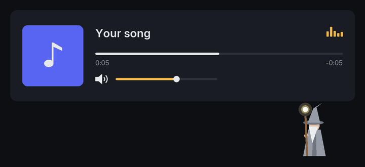

# shall-not-pass

*Stands watch so you don't have to.*
*For a life with fewer interruptions.*

[](https://github.com/andrewgwoodruff/shall-not-pass/actions/workflows/ci.yml)
[](LICENSE)


An over-engineered remote control that handles distractions for you. When an interruption starts in what you're listening to, it turns the volume down within about a tenth of a second. When your content comes back, it puts the volume back exactly where you had it.



---

## Install

Paste this in Terminal:

```bash
curl -fsSL https://raw.githubusercontent.com/andrewgwoodruff/shall-not-pass/main/install.sh | bash
```

macOS will ask for the permissions `shall-not-pass` needs to handle distractions for you. Click **OK**; without them, it can't do anything. (If a [supported app](#what-it-works-with) isn't open yet, the prompt appears the first time you open it.)

That's it. It starts automatically at login, and you can forget it's there.

<details>
<summary>Prefer to read the code first?</summary>

```bash
git clone https://github.com/andrewgwoodruff/shall-not-pass.git
cd shall-not-pass
# read shall-not-pass.sh and install.sh, then:
./install.sh
```

To watch what it does before installing, run `bash shall-not-pass.sh` and press `Ctrl-C` to stop. It puts the volume back before exiting.

</details>

**Requirements:** macOS 12 or later and a [supported app](#what-it-works-with). The [Xcode Command Line Tools](https://developer.apple.com/xcode/resources/) (`xcode-select --install`) are recommended. With them, the installer builds the fast version; without them, it installs a simpler version that checks every 2 seconds.

---

## What it works with

| App | Platform | Status |
|---|---|---|
| Spotify (desktop app) | macOS | Supported. Last tested with Spotify 1.3.6 on macOS 26.6 (Apple Silicon). |

More apps and platforms are [ideas on the roadmap](ROADMAP.md), not promises.

---

## What it touches, and what it doesn't

- **Changes:** the volume of the supported app that's playing, and nothing else.
- **Doesn't touch:** your Mac's overall volume, other apps, the supported app's files, or its network traffic. It never connects to the network itself.
- **Needs:** no admin password and no `sudo`. Everything installs into your home folder.
- **You stay in charge:** move the slider yourself during an interruption and it backs off until the interruption ends.
- **Can't get stuck at zero:** your volume is saved to disk before it's lowered, so a crash, a restart, or the app quitting can't lose it.
- **All of it is one file:** [`shall-not-pass.sh`](shall-not-pass.sh). The Swift source is at the bottom.

---

## How it works

Supported apps announce when your content starts, pauses, or comes back, but not when an interruption starts. So `shall-not-pass` predicts when each track will end, from its length and position, and checks every 50ms around that moment. In testing, interruptions started within 35ms of the predicted end and were muted within 57–82ms. A check every 2 seconds catches anything else.

The full story, with measurements: [How it works](docs/how-it-works.md).

---

## FAQ

**Is this a Spotify ad-blocker?**
No. It doesn't block, skip, or remove anything. It doesn't modify Spotify's app or interfere with its network traffic; it only talks to Spotify through the scripting interface Spotify provides for macOS. Everything Spotify plays, plays in full; `shall-not-pass` only moves Spotify's own volume slider down and back up. Unlike `shall-not-pass`, which is an over-engineered remote control focused on changing your volume when you don't want to listen to something, Spotify Premium removes ads completely for you and is a viable option for anyone who wants to completely remove ads from their Spotify experience.

**Does it change my Mac's volume?**
No. Only the supported app's own volume moves. Calls, videos, and everything else stay exactly as loud as they were.

**Will it open the app on its own?**
No. It only talks to the app while it's already running.

**Is it instant?**
Close. Most interruptions start at the end of a track, and those are silenced within about a tenth of a second. One that starts somewhere else (say, right after you skip) takes up to 2 seconds.

**Does it use much battery?**
No. It sleeps until the app sends an event or a track is about to end, plus one quick check every 2 seconds while something plays (every 10 while paused).

**What about other apps, Windows, or Android?**
Only the apps in [What it works with](#what-it-works-with) for now. Others are [ideas on the roadmap](ROADMAP.md).

---

## Update and uninstall

```bash
~/.local/share/shall-not-pass/update.sh      # update (works for either install method)
~/.local/share/shall-not-pass/uninstall.sh   # remove it (keeps the log)
```

Re-running the install command also updates. If it ever stops working, especially after a supported app updates, update first. Details, including how to tell which install method a machine used: [Troubleshooting](docs/troubleshooting.md).

---

## Troubleshooting

Check the log first:

```bash
tail -f ~/Library/Logs/shall-not-pass.log
```

Then see [Troubleshooting](docs/troubleshooting.md) for the step-by-step list. Still stuck? [Open an issue](https://github.com/andrewgwoodruff/shall-not-pass/issues/new/choose).

---

## Legal

This tool automates a volume adjustment you are fully entitled to make yourself. It does not modify any application, bypass any technical protection, or access any system you are not authorized to use.

Personal-use tool. Use at your own discretion. Not affiliated with or endorsed by the makers of any app it works with. [MIT License](LICENSE).
