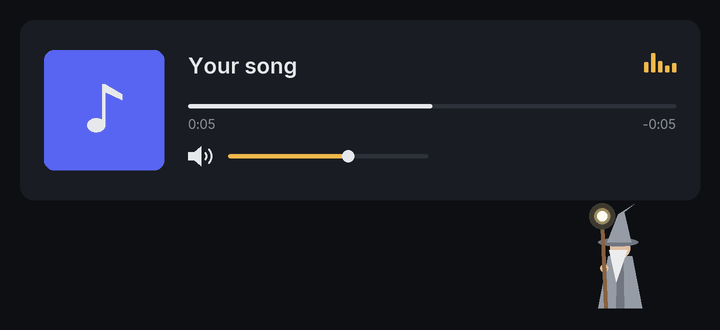

# shall-not-pass

*Stands watch so you don't have to.*
*For a life with fewer interruptions.*

[](https://github.com/andrewgwoodruff/shall-not-pass/actions/workflows/ci.yml)
[](https://github.com/andrewgwoodruff/shall-not-pass/actions/workflows/extension.yml)
[](LICENSE)

An over-engineered remote control that handles distractions for you. When something interrupts what you're watching or listening to, it turns the sound down within about a tenth of a second. When your content comes back, it turns the sound back up, exactly where you had it.



---

## Get it

Pick where you listen. Both can run at the same time.

### On your Mac

Paste this in Terminal:

```bash
curl -fsSL https://raw.githubusercontent.com/andrewgwoodruff/shall-not-pass/main/install.sh | bash
```

macOS will ask for the permissions `shall-not-pass` needs to handle distractions for you. Click **OK**; without them, it can't do anything. (If a [supported app](#what-it-works-with) isn't open yet, the prompt appears the first time you open it.)

That's it. It starts automatically at login, and you can forget it's there.

<details>
<summary>Prefer to read the code first?</summary>

```bash
git clone https://github.com/andrewgwoodruff/shall-not-pass.git
cd shall-not-pass
# read macos/shall-not-pass.sh and macos/install.sh, then:
./macos/install.sh
```

To watch what it does before installing, run `bash macos/shall-not-pass.sh` and press `Ctrl-C` to stop. It puts the volume back before exiting.

</details>

**Requirements:** macOS 12 or later and a [supported app](#what-it-works-with). The [Xcode Command Line Tools](https://developer.apple.com/xcode/resources/) (`xcode-select --install`) are recommended. With them, the installer builds the fast version; without them, it installs a simpler version that checks every 2 seconds.

### In your browser

For Chrome, Edge, Brave, Arc, and other Chromium browsers, on Mac, Windows, or Linux.

**[Add it from the Chrome Web Store](https://chromewebstore.google.com/detail/shall-not-pass/pkmfbbfomcbicfohbkfkoadbhimolnkd)**

It asks for no permissions beyond the [supported sites](#what-it-works-with), and updates itself.

<details>
<summary>Prefer to load it from the code?</summary>

1. Download or clone this repo.
2. Open `chrome://extensions` and turn on **Developer mode**.
3. Click **Load unpacked** and choose the `extension` folder.

</details>

---

## What it works with

| Where | Works with | Status |
|---|---|---|
| Mac | Spotify (desktop app) | Supported. Last tested with Spotify 1.3.6 on macOS 26.6 (Apple Silicon). |
| Browser | YouTube and Spotify's web player | New. Tested in Chrome on macOS; works in other Chromium browsers. |

More apps and platforms are [ideas on the roadmap](ROADMAP.md), not promises.

---

## What it touches, and what it doesn't

- **Changes:** on a Mac, the volume of the supported app that's playing. In the browser, whether that one tab is muted. Nothing else.
- **Doesn't touch:** your computer's overall volume, other apps, other tabs, the supported app's files, or its network traffic. It never connects to the network itself.
- **Collects nothing:** no analytics, no account, no data leaves your computer.
- **Needs:** no admin password and no `sudo`. The Mac version installs into your home folder.
- **You stay in charge:** turn the sound back up yourself during an interruption and it backs off until the interruption ends.
- **Can't get stuck silent:** the Mac version saves your volume to disk before lowering it, and the browser version only ever unmutes tabs it muted itself.

---

## How it works

- **Mac:** supported apps announce when your content starts, pauses, or comes back, but not when an interruption starts. So `shall-not-pass` predicts when each track will end, from its length and position, and checks every 50ms around that moment. In testing, interruptions were muted within 57–82ms. A check every 2 seconds catches anything else. [More detail](macos/docs/how-it-works.md).
- **Browser:** each supported site shows on the page when an interruption is playing. The extension notices the moment the page changes and mutes or unmutes the tab. [More detail](extension/docs/how-it-works.md).

---

## FAQ

**Is this a Spotify ad-blocker?**
No. It doesn't block, skip, or remove anything. It doesn't modify Spotify's app or interfere with its network traffic; on a Mac, it only talks to Spotify through the scripting interface Spotify provides for macOS, and in the browser it only mutes the tab, the same as clicking the tab's speaker icon. Everything Spotify plays, plays in full; `shall-not-pass` only turns the sound down and back up. Unlike `shall-not-pass`, which is an over-engineered remote control focused on changing your volume when you don't want to listen to something, Spotify Premium removes ads completely for you and is a viable option for anyone who wants to completely remove ads from their Spotify experience.

**Does it change my computer's volume?**
No. Only the supported app's own volume, or the one tab, changes. Calls, videos, and everything else stay exactly as loud as they were.

**Will it open the app on its own?**
No. It only talks to the app while it's already running.

**Is it instant?**
Close. In the browser, the tab is muted as soon as the page shows the interruption; on Spotify's web player, before it makes a sound. On a Mac, interruptions at the end of a track are silenced within about a tenth of a second; one that starts somewhere else (say, right after you skip) takes up to 2 seconds.

**Does it use much battery?**
No. The Mac version sleeps until the app sends an event or a track is about to end, plus one quick check every 2 seconds while something plays (every 10 while paused). The browser extension only wakes when the page changes.

**What about Windows, Linux, or Android?**
The browser extension works on Windows and Linux today. Other apps and platforms are [ideas on the roadmap](ROADMAP.md).

---

## Update and uninstall

**Mac:**

```bash
~/.local/share/shall-not-pass/update.sh      # update (works for either install method)
~/.local/share/shall-not-pass/uninstall.sh   # remove it (keeps the log)
```

Re-running the install command also updates. If it ever stops working, especially after a supported app updates, update first. Details, including how to tell which install method a machine used: [Troubleshooting](macos/docs/troubleshooting.md).

**Browser:** the Chrome Web Store version updates itself. To remove it, right-click its icon and choose **Remove from Chrome**, or use `chrome://extensions`. A copy you loaded from the code updates when you pull the repo and click the reload icon on its card.

---

## Troubleshooting

On a Mac, check the log first:

```bash
tail -f ~/Library/Logs/shall-not-pass.log
```

Then see [Troubleshooting](macos/docs/troubleshooting.md) for the step-by-step list. Still stuck, or something wrong in the browser? [Open an issue](https://github.com/andrewgwoodruff/shall-not-pass/issues/new/choose).

---

## Legal

This tool automates a volume adjustment you are fully entitled to make yourself. It does not modify any application, bypass any technical protection, or access any system you are not authorized to use.

Personal-use tool. Use at your own discretion. Not affiliated with or endorsed by the makers of any app or site it works with. [MIT License](LICENSE).
